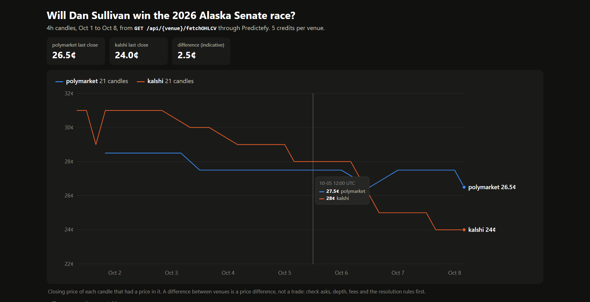

# Polymarket & Kalshi API in Python

Seven short scripts that read Polymarket and Kalshi with one Python package: prices, order books, the same market compared on both venues, price history, and a small backtest.

Every call goes through the [Predictefy API](https://predictefy.com/en/prediction-market-api?utm_source=youtube&utm_medium=video&utm_campaign=polymarket-kalshi-api-python&utm_content=github), which returns the same fields for every venue. The point of the repository is that one function works on two venues without changes:

```python
def search(venue, query, limit=3):
    return client.exchange(venue).fetch_markets(
        {"query": query, "status": "active", "sort": "volume", "limit": limit}
    )

search("polymarket", "Dan Sullivan")
search("kalshi", "Dan Sullivan")
```

It is read-only. It never places an order and never asks for a wallet key or a venue login.



> A price difference between two venues is a place to look, not a trade. The API labels it `indicative price comparison`.

## Quick start

You need Python 3.10 or newer and a Predictefy API key from [portal.predictefy.com/keys](https://portal.predictefy.com/keys). The free plan is enough for steps 1 to 6.

```bash
git clone https://github.com/Ong-pogs/polymarket-kalshi-api-python
cd polymarket-kalshi-api-python
python -m venv .venv
.venv\Scripts\Activate.ps1          # macOS and Linux: source .venv/bin/activate
pip install -r requirements.txt     # installs predictefy==1.0.0b9
cp .env.example .env                # Windows PowerShell: Copy-Item .env.example .env
```

Open `.env`, paste your key after `PREDICTEFY_API_KEY=`, then run the first step:

```bash
python step1_first_call.py
```

The package is on a beta line, so the version is pinned. Check [PyPI](https://pypi.org/project/predictefy/) before you raise it.

## The steps

| Script | What it shows | Predictefy call | Credits per run |
|---|---|---|---|
| `step1_first_call.py` | Search Polymarket | `GET /api/polymarket/fetchMarkets` | 1 |
| `step2_same_code_kalshi.py` | The same search on Kalshi, and the fields both venues share | `GET /api/{venue}/fetchMarkets` | 2 |
| `step3_order_book.py` | An order book from each venue | `GET /api/{venue}/fetchOrderBook` | 12 |
| `step4_compare_venues.py` | One market's bid and ask on both venues | `GET /api/router/compareMarketPrices` | 16 |
| `step5_price_history.py` | Four-hour candles from each venue, and a chart | `GET /api/{venue}/fetchOHLCV` | 12 |
| `step6_backtest.py` | A buy-the-dip rule replayed over those candles | `GET /api/{venue}/fetchOHLCV` | 12 |
| `step7_replay_backtest.py` | The same rule on every recorded quote (Builder plan) | `GET /v1/history/replay` | 16 once, then 0 |

Every script ends by printing what it spent, read from the `X-Credits-Charged` response header. Steps 1 to 6 together cost 55 credits. The figures are from runs on 8 October 2026; the weights are listed in [Pricing, credits & billing](https://docs.predictefy.com/guides/credits/).

`common.py` holds the shared setup (the key, the client, the credit counter). `chart.py` writes the two charts to `out/` as plain HTML.

## What the free plan allows

| | Free | Builder ($48.88 a month) |
|---|---|---|
| Credits a month | 25,000 | 500,000 |
| Price history (`fetchOHLCV`) | the last 7 days | 12 months |
| Replay route (`/v1/history/replay`) | not included | included |
| Cross-venue matching | limited, results may be delayed | yes |

Source: [the plan table](https://docs.predictefy.com/guides/credits/#feature-access), read on 8 October 2026.

A history request that reaches back further than your plan allows is refused with `403 PLAN_REQUIRED`; it is not shortened. So on a free key:

```bash
python step6_backtest.py             # 7 days: works
python step6_backtest.py --days 30   # 403 PLAN_REQUIRED, and the script prints what to do
python step7_replay_backtest.py --download   # 403 PLAN_REQUIRED
```

## Following a different market

The scripts follow one question on both venues: whether Dan Sullivan wins the 2026 Alaska Senate race. That market closes after the election on 3 November 2026. To follow another one:

1. Run `step2_same_code_kalshi.py` with your own search text (edit the query at the bottom of the file) and copy the market id from each venue.
2. Put them in `.env`:

```bash
PM_MARKET=634974
KALSHI_MARKET=KXAKSENATE-26NOV03-DSUL
```

Ids do not cross venues. Step 4 is how you check that two markets are the same question: `compareMarketPrices` takes one market and returns the others Predictefy has matched to it.

## Record once, replay for free

Any step can save the responses it receives and replay them later without the network, a key or credits. That is useful while you change how something is printed or calculated.

```bash
# PowerShell
$env:PREDICTEFY_RECORD = "recordings/today"; python step5_price_history.py
$env:PREDICTEFY_RECORD = $null
$env:PREDICTEFY_REPLAY = "recordings/today"; python step5_price_history.py
```

A replayed run starts with a `[replay]` line that says when the responses were recorded. The `recordings/` folder is ignored by git.

## What to know before you trust a number

- **A price gap is not a trade.** Step 4 prints the label the API sends, `indicative price comparison`, and Predictefy's verdict on whether the two markets settle on the same terms. On 8 October 2026 the two Alaska markets were 3 cents apart and judged not equivalent, because they differ on who decides the result and how the deadline is handled. Asks, depth and fees decide the rest.
- **Read how a candle was built.** Every candle carries `source`, `sourceType`, `quality` and `isTrueCandle`. The four-hour candles used here are rollups Predictefy builds from finer data, not candles a venue published.
- **Empty buckets come back as zeros.** `candles()` drops any candle with no price in it. On 8 October 2026, one-hour Kalshi candles for the last week came back as rows of zeros, while four-hour candles had prices on both venues. That is why the scripts ask for `4h`.
- **Volume is in different units.** Polymarket reports dollars and Kalshi reports contracts. `volume24hUnit` says which.
- **Step 6 is a first look.** It trades at candle closes with no spread, no fees and no limit on size. Step 7 is stricter: orders fill on the next quote, take at most a quarter of the size on show, and pay the venue's fees.
- **Replay data is not available for every outcome.** For this market Predictefy had top-of-book rows for Kalshi and none for Polymarket, so step 7 runs on Kalshi.
- **A backtest is not a forecast.** The rule in this repository lost money on the days it was tested. It is here to show the method.

## Tests

```bash
pip install -r requirements-dev.txt
python -m pytest
```

The tests use a fake transport and synthetic responses. They need no key and make no requests.

## License

MIT. See [LICENSE](LICENSE).
